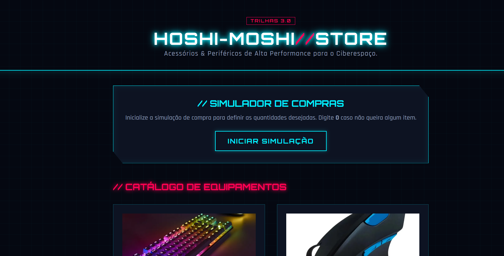

# Desafio 1 — Hosi-Moshi // Store: Simulador de Compras

## Informações do Projeto
- **Aluno:** Alberthy Cristhyan
- **Trilha:**  DESENVOLVIMENTO MOBILE / (Trilhas)

## Apresentação da Loja
A **Hosi-Moshi // Store** é uma loja fictícia de periféricos e acessórios de informática com temática **Cyberpunk/Neon**. A plataforma combina uma interface futurista, layout responsivo e recursos visuais interativos, nos cards e a **visualização expandida de imagens via Modal/Lightbox (Popup)**.

### Produtos Disponíveis
1. **Teclado Mecânico RGB:** R$ 250,00
2. **Mouse Ergonômico Sem Fio:** R$ 120,00
3. **Suporte Articulado para Monitor:** R$ 180,00
4. **Headset Gamer 7.1:** R$ 200,00

## Tecnologias Utilizadas
- **HTML5:** Estruturação semântica da página, integração de favicons e tags para navegação e modal.
- **CSS3:** Estilização futurista Cyberpunk (*Neon Glow*, variáveis CSS, desfoque de fundo `backdrop-filter`, grid responsivo) e transformações 3D (`perspective`, `rotateY` e `@keyframes`).
- **Google Fonts:** Tipografias *Orbitron* e *Rajdhani* para a identidade visual tecnológica.
- **JavaScript (ES6):** Manipulação de interatividade, abertura e fechamento de modal/popup, coleta de dados via `prompt()`, tratamento de erros/cancelamentos com `isNaN()`, cálculos automatizados e regras de desconto.

## Instruções de Execução
1. Clone este repositório ou baixe os arquivos para a sua máquina.
2. Certifique-se de manter as imagens nas pastas correspondentes (`assets/` e a imagem `screenshot.png` na raiz do projeto).
3. Abra o arquivo `index.html` em qualquer navegador web (Google Chrome, Firefox, Edge, etc.).
4. Passe o mouse sobre as imagens dos produtos para visualizar o efeito de rotação 3D.
5. Clique sobre qualquer imagem para abri-la em tamanho expandido no Modal/Popup.
6. Clique no botão **"INICIAR SIMULAÇÃO"** para selecionar as quantidades desejadas de cada produto e calcular o total do pedido.

## Captura de Tela

## Testes Realizados
- **Nenhum produto selecionado (0 em todos os campos):** Exibe mensagem de alerta informando que nenhum produto foi selecionado e cancela a transação sem erros.
- **Visualização Modal/Popup de Imagem:** Verificada a abertura centralizada da imagem com brilho neon ao clicar, além do fechamento ao clicar no botão de fechar (`X`) ou no fundo.
- **Compra com Desconto (Acima de R$ 300,00):** Aplicação e dedução exata do desconto cibernético de 10% sobre o valor total.
- **Valores inválidos ou cancelamento no prompt:** O sistema trata entradas de texto ou valores negativos como `0`, mantendo o fluxo da aplicação estável.

## Dificuldades Encontradas e Aprendizados
Um dos principais desafios foi à funcionalidade de clique para expansão em Modal/Popup, garantindo que o efeito de transição não interferisse na responsividade da página. Aprendi a utilizar a propriedade `perspective` no CSS, a criar manipuladores de eventos em JavaScript para controle de modais (`abrirModal` e `fecharModal`) e a tratar dados numéricos provenientes do `prompt()` com a devida conversão e formatação (`.toFixed(2)`).

## Uso de Inteligência Artificial
A IA foi utilizada como ferramenta de apoio no planejamento da arquitetura CSS (estilo Cyberpunk/Neon), na criação das animações 3D de rotação e na estruturação do modal para expansão das imagens. Adaptei os códigos aos produtos e identidade visual da **Hosi-Moshi // Store**, inclui validações para todos os itens do catálogo e testei manualmente as interações e simulações no navegador.